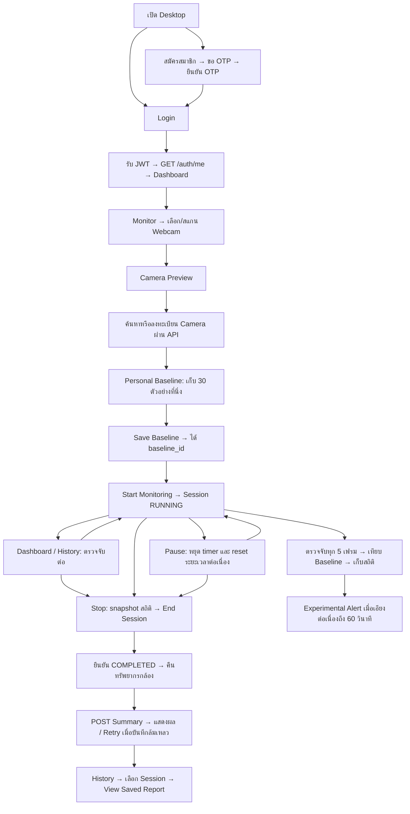

# PostGuard: flow และผลทดสอบ

วันที่ตรวจ: 15 ตุลาคม 2026 — working tree บน `feature/desktop` ยังไม่ commit

## Flow ที่ใช้งานอยู่



- Desktop ใช้ PySide6/OpenCV/MediaPipe; API เป็น FastAPI; ข้อมูลถาวรอยู่ PostgreSQL/Supabase
- `desktop/app/core/config.py` ชี้ API ไป `http://127.0.0.1:8001`
- Login เก็บ JWT ใน `TokenStore` ในหน่วยความจำ แล้วแนบ Authorization ใน API requests
- Baseline ต้องเห็นทั้ง Pose และ Face; เก็บ 30 ตัวอย่าง และตรวจส่วนเบี่ยงเบนมาตรฐานไหล่/คอไม่เกิน 2 องศา หากไม่พบหรือขยับมากจะเริ่มเก็บใหม่
- Monitoring ใช้ timer 30 ms และตรวจจับทุก 5 เฟรม; อัตราจริงขึ้นกับเวลาประมวลผล
- Threshold ทดลองเริ่มที่ 0 ซึ่งปิดการจำแนกเอียงคอ ต้องกำหนดมากกว่า 0 ก่อนทดลอง Alert
- Threshold นี้ยังไม่ใช่เกณฑ์ทางคลินิกที่ผ่าน validation; Full Risk Score ยังไม่พร้อม แสดง N/A และส่ง NULL
- Pause/Resume ใช้ session_id เดิม และยังถือ camera resource ไว้; เวลาท่าทางต่อเนื่องจะเริ่มใหม่หลัง Pause
- Dashboard/History ไม่จบ Session; ปุ่ม Monitor กลับหน้า Session เดิม และ sidebar แสดงสถานะพร้อม Pause/Resume/Stop
- Logout/ปิดหน้าต่างตามปกติจะ End และ Save ก่อนล้าง token; ถ้าล้มเหลวจะคงหน้าต่าง/ข้อมูลไว้ให้ Retry
- ถ้ามี Summary บันทึกไม่สำเร็จ จะไม่ให้เริ่ม Session ใหม่ทับข้อมูลที่รอ Retry
- การทำงานต่อขณะเปลี่ยนหน้าใช้ Qt timer เดิม ไม่ใช่ background thread; synchronous API ยังทำให้ timer รอระหว่าง request
- ระยะเวลา Session รวมเวลาพัก; Active duration = total_duration - paused_duration
- Alert duration คือเวลาที่ event เปิดอยู่ ไม่ใช่ระยะเวลาท่าทางเสี่ยงทั้งหมด
- Summary บันทึกหลัง COMPLETED เท่านั้น; Session หนึ่งมี Summary หนึ่งรายการ; Retry เมื่อพบ 409 จะอ่านรายงานเดิมกลับมา
- Saved Report อ่านค่าจากฐานข้อมูล ไม่คำนวณ Detection ใหม่

## ผลทดสอบที่ยืนยันได้

| ขอบเขต | วิธี | ผล |
|---|---|---|
| Login/JWT | บัญชีชั่วคราว, hash password จริง, Login API, Bearer token | ผ่าน รวมรหัสผ่านผิดและ token หมดอายุ |
| Camera/Baseline API | สร้างผ่าน API และอ่าน baseline กลับ | ผ่านบน Supabase; ใช้ค่าตัวเลขทดสอบ |
| Session/Alert | Start → สร้าง Alert → Pause → Resume → End | ผ่าน; Alert ถูกปิด |
| Summary | Save → GET → list → POST ซ้ำ | ผ่าน; ค่าตรง และ duplicate ได้ 409 |
| Ownership | Login อีกบัญชีแล้วอ่าน/เขียนรายงานและอ่าน Alert | ถูกปฏิเสธ 404; รายการ Summary ว่าง |
| Desktop flow | PySide6 offscreen, กล้อง/ผล Detection/API จำลอง | Preview → Baseline 30 samples → Save → Monitoring → Pause/Resume → Stop → Summary ผ่าน |
| Error/Retry | จำลอง End ล้มเหลว และ Summary API ล้มเหลว | เก็บสถิติเพื่อ Retry ได้ |
| History | UI tests จำลอง API | เปิด Saved Report, ไม่มีรายงาน, API ล้มเหลว ผ่าน |
| Webcam จริง | เปิด device 0, ประมวลผล 10 เฟรมด้วย DetectionService จริง | Face 10/10, Pose 0/10; ปิดกล้องแล้ว ไม่บันทึกภาพ |
| Schema | ตรวจ revision และ columns แบบ read-only | `3f50ad4657ae`; คอลัมน์ Summary ครบ |

การทดสอบ Supabase ใช้ FastAPI TestClient เรียก router จริงและ SQLAlchemy ต่อฐานข้อมูลจริง ภายใน transaction ที่ rollback ภายหลัง ไม่ใช่การกด Desktop ผ่าน HTTP server ที่พอร์ต 8001 ครบวงจร บัญชีและข้อมูลทดสอบถูก rollback; sequence ของ ID อาจเพิ่มขึ้นได้ตามพฤติกรรม PostgreSQL

## ปัญหาที่พบจากการทดสอบและอ่านโค้ด

1. **แก้แล้ว — การเปลี่ยนหน้าจบ Session โดยไม่มี Summary:** เอาการจบ Session ออกจาก hideEvent; การเปลี่ยนหน้าคง timer/camera/samples ไว้ ปุ่ม Monitor กลับ Session เดิม ปุ่ม Stop ส่วนกลางเรียก snapshot/end/save
2. **แก้แล้ว — ปุ่ม Pause ยังเปิดหลัง Stop:** reset สถานะและ disable ปุ่มบนหน้าและ sidebar หลังจบ Session
3. **Login มี debug print ของ response:** `desktop/app/ui/login_window.py` พิมพ์ login response ซึ่งมี access token ควรนำออกก่อนใช้งานจริง การทดสอบครั้งนี้ไม่เรียก UI login พร้อม token จริงและไม่แสดง token ในผลทดสอบ
4. **Pose จริงยังไม่พบ:** ยังยืนยัน calibration และ monitoring ท่าทางจริงไม่ได้ ต้องจัดกล้องให้เห็นศีรษะและไหล่ทั้งสองข้างแล้วทดสอบใหม่ การตรวจ Face ผ่านไม่เท่ากับ Pose ผ่าน

แก้ข้อ 1–2 และเพิ่ม tests สำหรับ navigation, timer ขณะซ่อนหน้า, ปุ่มส่วนกลาง, Stop ขณะ Pause, Close/Logout สำเร็จและล้มเหลว รวมถึงกล้องอ่านไม่สำเร็จแล้ว Retry End โดยรักษาสถิติไว้ ข้อ 3–4 ยังเป็นข้อจำกัด ไม่ได้แก้ Camera/Detection ของทีม

## ส่วนที่ยังไม่ได้ยืนยัน

- ส่ง/รับ OTP ทางอีเมลจริง, Registration ครบวงจร และ Forgot/Reset Password
- ลำดับ Camera Tilt Correction/Context Filter ตามแบบออกแบบ: ในเส้นทาง Desktop ที่อ่านพบการเรียก Detection โดยตรง ยังไม่ยืนยันการเชื่อมขั้นตอนเหล่านี้
- ความแม่นยำเชิงมุมและเกณฑ์ความเสี่ยงทางคลินิก
- เปิด GUI จริงและกดตลอด flow ตั้งแต่ Login จนถึง History ด้วยค่าจาก Webcam จริง
- การทำงานระยะยาวและการตอบสนอง UI ระหว่าง API ช้า (API ปัจจุบันเรียกแบบ synchronous)

## คำสั่งทดสอบซ้ำ (PowerShell จาก project root)

```powershell
cd backend
.\.venv\Scripts\python.exe -m unittest test_session_summaries -v
# คำสั่งถัดไปเชื่อม DB ที่ตั้งใน .env, ใช้ข้อมูลชั่วคราวแล้ว rollback
.\.venv\Scripts\python.exe check_summary_database.py --rollback-test
cd ..\desktop
.\.venv\Scripts\python.exe -m unittest test_desktop_workflow test_risk_engine test_posture_duration_tracker test_experimental_alert_service test_alert_history_service test_session_summary_service test_saved_report -v
```

เปิดแอปจริงด้วยสอง terminal:

```powershell
# Terminal 1: project root
cd backend
.\.venv\Scripts\python.exe -m uvicorn app.main:app --host 127.0.0.1 --port 8001
```

```powershell
# Terminal 2: project root
cd desktop
.\.venv\Scripts\python.exe -m app.main
```

สามารถเปลี่ยน Dashboard/History ระหว่างตรวจจับได้ กด **Stop Monitoring** บน sidebar เพื่อจบและบันทึกจากหน้าใดก็ได้ หากบันทึกไม่สำเร็จ ให้ Retry ในหน้า Summary ก่อน Logout/ปิดแอปหรือเริ่ม Session ใหม่ การกู้คืนเมื่อ process ถูกบังคับปิดหรือเครื่องดับยังไม่รองรับ
