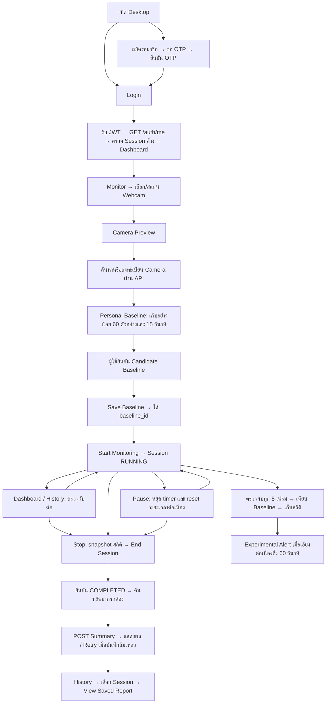

# PostGuard: flow และผลทดสอบ

## Personal Baseline verification — 16 October 2026

- Backend unit/integration tests: 30 passed.
- Desktop unit tests: 116 passed, including the four-feature Detection Contract,
  collector confirmation state and full Preview-to-Summary workflow.
- Supabase migration is at `b8e7c4d2a190`; all nine Personal Baseline validation
  columns were confirmed present.
- The separate hardware camera test still requires a locally accessible webcam.

วันที่ตรวจ: 15 ตุลาคม 2026 — working tree บน `feature/desktop` ยังไม่ commit

## Flow ที่ใช้งานอยู่



- Desktop ใช้ PySide6/OpenCV/MediaPipe; API เป็น FastAPI; ข้อมูลถาวรอยู่ PostgreSQL/Supabase
- `desktop/app/core/config.py` ชี้ API ไป `http://127.0.0.1:8001`
- Login เก็บ JWT ใน `TokenStore` ในหน่วยความจำ แล้วแนบ Authorization ใน API requests
- หลัง Login และก่อนเปิด Monitor/Start จะตรวจ Session RUNNING/PAUSED ที่ไม่มีอยู่ในแอปรอบนี้ หากพบจะให้เลือกจบเป็น INTERRUPTED หรือยกเลิก (ไม่ตัดสินเองว่าเป็น Session เสีย เพราะอาจยังทำงานบนอีกเครื่อง)
- Session INTERRUPTED เก็บประวัติเดิมและไม่สร้าง Summary; ไม่เติม ended_at ที่ไม่ทราบ API คืน total_duration/paused_duration เป็น null เพื่อให้แสดง N/A โดยไม่แก้ schema หรือเขียนทับตัวเลขดิบที่มีอยู่
- Alert ที่ยังไม่ปิดใน Session INTERRUPTED แสดง INCOMPLETE, duration=null และไม่นับเป็น active/closed duration; Alert ที่ปิดแล้วคงค่าเดิม
- Recovery endpoint `POST /sessions/{session_id}/interrupt` ตรวจเจ้าของ รองรับ Retry และไม่อนุญาตให้เปลี่ยน COMPLETED เป็น INTERRUPTED
- หากตรวจ Session ค้างไม่สำเร็จหรือผู้ใช้ยกเลิก จะไม่เริ่ม Session ใหม่ ผู้ใช้กด Monitor เพื่อทดลองใหม่ได้
- Baseline ต้องเห็นทั้ง Pose และ Face และมีค่า shoulder tilt, neck lateral tilt, neck flexion และ eye-distance proxy ครบ เก็บอย่างน้อย 60 ตัวอย่างภายในเวลาอย่างน้อย 15 วินาที ตรวจ valid ratio และความนิ่ง ก่อนให้ผู้ใช้ยืนยัน Candidate Baseline
- Monitoring ใช้ timer 30 ms และตรวจจับทุก 5 เฟรม; อัตราจริงขึ้นกับเวลาประมวลผล
- Threshold ทดลองเริ่มที่ 0 ซึ่งปิดการจำแนกเอียงคอ ต้องกำหนดมากกว่า 0 ก่อนทดลอง Alert
- Threshold นี้ยังไม่ใช่เกณฑ์ทางคลินิกที่ผ่าน validation; Full Risk Score ยังไม่พร้อม แสดง N/A และส่ง NULL
- Pause/Resume ใช้ session_id เดิม และยังถือ camera resource ไว้; เวลาท่าทางต่อเนื่องจะเริ่มใหม่หลัง Pause
- Dashboard/History ไม่จบ Session; ปุ่ม Monitor กลับหน้า Session เดิม และ sidebar แสดงสถานะพร้อม Pause/Resume/Stop
- Logout/ปิดหน้าต่างตามปกติจะ End และ Save ก่อนล้าง token; ถ้าล้มเหลวจะคงหน้าต่าง/ข้อมูลไว้ให้ Retry
- ถ้ามี Summary บันทึกไม่สำเร็จ จะไม่ให้เริ่ม Session ใหม่ทับข้อมูลที่รอ Retry
- การทำงานต่อขณะเปลี่ยนหน้าใช้ Qt timer เดิม ไม่ใช่ background thread; synchronous API ยังทำให้ timer รอระหว่าง request
- ระยะเวลา Session รวมเวลาพัก; Active duration = total_duration - paused_duration
- Alert duration คือเวลาที่ event เปิดอยู่ ไม่ใช่ระยะเวลาท่าทางเสี่ยงทั้งหมด
- Summary บันทึกหลัง COMPLETED เท่านั้น; Session หนึ่งมี Summary หนึ่งรายการ; Retry เมื่อพบ 409 จะอ่านรายงานเดิมกลับมา
- Saved Report อ่านค่าจากฐานข้อมูล ไม่คำนวณ Detection ใหม่

## ผลทดสอบที่ยืนยันได้

| ขอบเขต | วิธี | ผล |
|---|---|---|
| Login/JWT | บัญชีชั่วคราว, hash password จริง, Login API, Bearer token | ผ่าน รวมรหัสผ่านผิดและ token หมดอายุ |
| Camera/Baseline API | สร้างผ่าน API และอ่าน baseline กลับ | ผ่านบน Supabase; ใช้ค่าตัวเลขทดสอบ |
| Session/Alert | Start → สร้าง Alert → Pause → Resume → End | ผ่าน; Alert ถูกปิด |
| Summary | Save → GET → list → POST ซ้ำ | ผ่าน; ค่าตรง และ duplicate ได้ 409 |
| Ownership | Login อีกบัญชีแล้วอ่าน/เขียนรายงานและอ่าน Alert | ถูกปฏิเสธ 404; รายการ Summary ว่าง |
| Desktop flow | PySide6 offscreen, กล้อง/ผล Detection/API จำลอง | Preview → Baseline validation → User confirmation → Save → Monitoring → Pause/Resume → Stop → Summary ผ่าน |
| Error/Retry | จำลอง End ล้มเหลว และ Summary API ล้มเหลว | เก็บสถิติเพื่อ Retry ได้ |
| History | UI tests จำลอง API | เปิด Saved Report, ไม่มีรายงาน, API ล้มเหลว ผ่าน |
| Webcam จริง | เปิด device 0, ประมวลผล 10 เฟรมด้วย DetectionService จริง | Face 10/10, Pose 0/10; ปิดกล้องแล้ว ไม่บันทึกภาพ |
| Schema | ตรวจ revision และ columns แบบ read-only | `3f50ad4657ae`; คอลัมน์ Summary ครบ |

การทดสอบ Supabase ใช้ FastAPI TestClient เรียก router จริงและ SQLAlchemy ต่อฐานข้อมูลจริง ภายใน transaction ที่ rollback ภายหลัง ไม่ใช่การกด Desktop ผ่าน HTTP server ที่พอร์ต 8001 ครบวงจร บัญชีและข้อมูลทดสอบถูก rollback; sequence ของ ID อาจเพิ่มขึ้นได้ตามพฤติกรรม PostgreSQL

## ปัญหาที่พบจากการทดสอบและอ่านโค้ด

1. **แก้แล้ว — การเปลี่ยนหน้าจบ Session โดยไม่มี Summary:** เอาการจบ Session ออกจาก hideEvent; การเปลี่ยนหน้าคง timer/camera/samples ไว้ ปุ่ม Monitor กลับ Session เดิม ปุ่ม Stop ส่วนกลางเรียก snapshot/end/save
2. **แก้แล้ว — ปุ่ม Pause ยังเปิดหลัง Stop:** reset สถานะและ disable ปุ่มบนหน้าและ sidebar หลังจบ Session
3. **แก้แล้ว — Login มี debug print ของ response:** นำ log ของ Login/Me response ออก และมี test ตรวจว่าไม่พิมพ์ token/password
4. **Pose จริงยังไม่พบ:** ยังยืนยัน calibration และ monitoring ท่าทางจริงไม่ได้ ต้องจัดกล้องให้เห็นศีรษะและไหล่ทั้งสองข้างแล้วทดสอบใหม่ การตรวจ Face ผ่านไม่เท่ากับ Pose ผ่าน

แก้ข้อ 1–3 และเพิ่ม tests สำหรับ navigation, timer ขณะซ่อนหน้า, ปุ่มส่วนกลาง, Stop ขณะ Pause, Close/Logout สำเร็จและล้มเหลว รวมถึงกล้องอ่านไม่สำเร็จแล้ว Retry End โดยรักษาสถิติไว้ ข้อ 4 ยังเป็นข้อจำกัด ไม่ได้แก้ Camera/Detection ของทีม

การทดสอบล่าสุดหลังเพิ่ม Session Recovery: Backend 9 tests และ Desktop 56 tests ผ่าน รวมการยกเลิก recovery, เครือข่ายล้มเหลว, response หายแล้วตรวจ GET ซ้ำ, สิทธิ์ข้ามผู้ใช้, ไม่สร้าง Summary เทียม และ Login ไม่พิมพ์ token ทดสอบ recovery บน Supabase ผ่านด้วยข้อมูลชั่วคราวที่ rollback แล้ว ไม่มีการจบ Session ของผู้ใช้จริง

## ส่วนที่ยังไม่ได้ยืนยัน

- ส่ง/รับ OTP ทางอีเมลจริง และ Registration ครบวงจร (Password Reset UI/API ผ่านการทดสอบที่จำลองการส่งอีเมลแล้ว)
- ลำดับ Camera Tilt Correction/Context Filter ตามแบบออกแบบ: ในเส้นทาง Desktop ที่อ่านพบการเรียก Detection โดยตรง ยังไม่ยืนยันการเชื่อมขั้นตอนเหล่านี้
- ความแม่นยำเชิงมุมและเกณฑ์ความเสี่ยงทางคลินิก
- เปิด GUI จริงและกดตลอด flow ตั้งแต่ Login จนถึง History ด้วยค่าจาก Webcam จริง
- การทำงานระยะยาวและการตอบสนอง UI ระหว่าง API ช้า (API ปัจจุบันเรียกแบบ synchronous)

## คำสั่งทดสอบซ้ำ (PowerShell จาก project root)

```powershell
cd backend
.\.venv\Scripts\python.exe -m unittest discover -s tests/unit -p "test_*.py" -v
# คำสั่งถัดไปเชื่อม DB ที่ตั้งใน .env, ใช้ข้อมูลชั่วคราวแล้ว rollback
.\.venv\Scripts\python.exe -m scripts.check_summary_database --rollback-test
cd ..\desktop
.\.venv\Scripts\python.exe -m unittest discover -s tests/unit -p "test_*.py" -v
```

เปิดแอปจริงด้วยสอง terminal:

```powershell
# Terminal 1: project root
cd backend
.\.venv\Scripts\python.exe -m uvicorn app.main:app --host 127.0.0.1 --port 8001
```

```powershell
# Terminal 2: project root
cd desktop
.\.venv\Scripts\python.exe -m app.main
```

สามารถเปลี่ยน Dashboard/History ระหว่างตรวจจับได้ กด **Stop Monitoring** บน sidebar เพื่อจบและบันทึกจากหน้าใดก็ได้ หากบันทึกไม่สำเร็จ ให้ Retry ในหน้า Summary ก่อน Logout/ปิดแอปหรือเริ่ม Session ใหม่ หาก process ถูกบังคับปิดหรือเครื่องดับ เปิดแอปและ Login อีกครั้งเพื่อเลือกจบ Session ค้างเป็น INTERRUPTED ยังไม่มี heartbeat หรือการกู้สถิติที่อยู่ในหน่วยความจำก่อนแอปดับ

## Password Reset Desktop

หน้า Login มีปุ่ม **Forgot Password?** เปิด dialog 3 ขั้นตอน:

1. กรอกอีเมล `@ku.th` → `POST /auth/forgot-password`
2. กรอก OTP 6 หลัก → `POST /auth/verify-reset-otp` (มี Send New OTP และ Change Email)
3. กรอกรหัสผ่านใหม่พร้อมยืนยัน → `POST /auth/reset_password` → กลับ Login

ชื่อ endpoint สุดท้ายใช้ underscore ตาม Backend เดิม ไม่ใช่ `/reset-password`
รหัสผ่านต้องยาวอย่างน้อย 8 ตัว มีตัวใหญ่ ตัวเล็ก ตัวเลข และอักขระพิเศษ OTP มีอายุ 5 นาที และ reset token มีอายุ 10 นาทีตาม Backend
Reset token อยู่เฉพาะใน dialog ไม่เก็บใน TokenStore และล้างพร้อมช่องรหัสผ่านเมื่อยกเลิกหรือสำเร็จ ไม่พิมพ์ข้อมูลเหล่านี้ลง log
หากคำขอเปลี่ยนรหัสผ่านขาดการเชื่อมต่อ ระบบจะแจ้งว่าผลยังไม่ยืนยัน และให้ลอง Login ด้วยรหัสใหม่ก่อนขอ reset อีกครั้ง

ทดสอบ Desktop รวม 65 tests ผ่าน (เพิ่ม Password Reset 9 tests) และทดสอบ API บน Supabase ผ่านกรณี OTP ผิด/หมดอายุ, ส่งใหม่, รหัสผ่านไม่ผ่านเงื่อนไข, เปลี่ยนรหัสผ่าน, reset token ใช้ซ้ำ, Login ด้วยรหัสเก่า/ใหม่ โดย mock การส่งอีเมลทั้งหมดและ rollback ข้อมูลทดสอบ ไม่มีการแก้รหัสผ่านบัญชีจริง

```powershell
# จาก project root
cd desktop
.\.venv\Scripts\python.exe -m unittest tests.unit.test_password_reset -v
cd ..\backend
# ใช้ฐานข้อมูลที่กำหนดใน .env และ rollback ข้อมูลทดสอบ
.\.venv\Scripts\python.exe -m scripts.check_password_reset --rollback-test
```

การทดสอบด้วยอีเมลจริงยังต้องทำผ่านหน้า Forgot Password ด้วยบัญชีของผู้ใช้เอง

## Dashboard

- แสดงสถานะ Session ปัจจุบันและปุ่ม Start/Return to Monitoring, View History
- โหลดข้อมูลจริงจาก `GET /sessions` หลัง Login, เมื่อกลับ Dashboard และเมื่อกด Refresh
- โหลดผ่าน Qt thread pool เพื่อไม่บล็อก timer ตรวจจับระหว่างรอ Dashboard API
- สรุปจำนวน COMPLETED, เวลาตรวจจับรวม (total_duration - paused_duration เฉพาะ COMPLETED ที่มีเวลาถูกต้อง), และจำนวน INTERRUPTED
- ตารางแสดง 5 Session ล่าสุด; Session ที่ยังทำงาน/ขาดข้อมูลแสดงเวลาตรวจจับ N/A
- หาก API ล้มเหลวแสดงข้อมูลไม่พร้อมและให้ Refresh ไม่แทนด้วยศูนย์
- Posture insights เป็น placeholder Coming soon; Full Risk Score/Blink Rate เป็น N/A ไม่มีคะแนนสมมติ
- `docs/assets/dashboard-preview.png` เป็นภาพตัวอย่างที่ใช้ข้อมูลจำลองสำหรับตรวจ layout เท่านั้น ไม่ใช่ข้อมูลในบัญชีผู้ใช้
- Desktop tests รวม 71 tests ผ่าน รวม Dashboard 6 tests: การรวมเวลา, ข้อมูลไม่ครบ, ไม่มีข้อมูล/API error, ปุ่มและสถานะ, asynchronous refresh และจำกัดรายการล่าสุด

```powershell
cd desktop
.\.venv\Scripts\python.exe -m unittest tests.unit.test_dashboard -v
```
