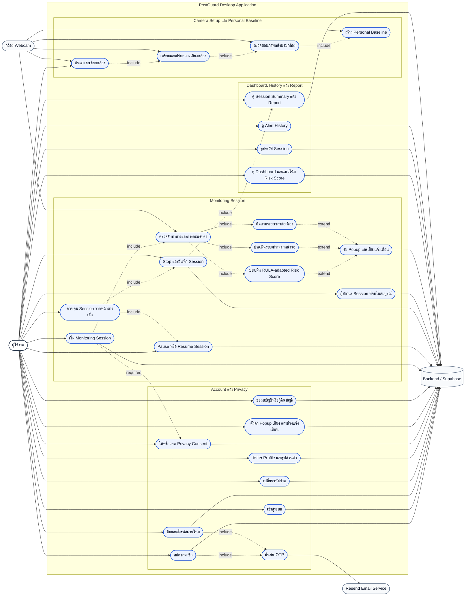

# PostGuard Use Case Diagram

เอกสารนี้แสดง Use Case หลักของ PostGuard Desktop Application ตามขอบเขตระบบปัจจุบันและข้อกำหนด ToR

## Actor

| Actor | หน้าที่ |
| --- | --- |
| ผู้ใช้งาน | จัดการบัญชี ตั้งค่าระบบ เตรียมกล้อง สร้าง Baseline เริ่มและควบคุม Session รับการแจ้งเตือน และดูรายงาน |
| กล้อง Webcam | ส่งภาพให้ขั้นตอน Camera Setup, Personal Baseline และ Monitoring โดยประมวลผลภาพภายในเครื่อง |
| Resend Email Service | ส่ง OTP สำหรับการสมัครสมาชิกและการตั้งรหัสผ่านใหม่ |
| Backend / Supabase | ตรวจสอบสิทธิ์และเก็บข้อมูลผู้ใช้ Consent, Settings, Baseline, Session, Alert และ Report |

## ความสัมพันธ์สำคัญ

- การเริ่ม Monitoring ต้องมี Privacy Consent ที่ยังใช้งานอยู่
- Camera Setup, Camera Preparation, Adjusted Preview และ Personal Baseline เป็นขั้นตอนก่อนเริ่ม Session
- การตรวจจับท่าทางประกอบด้วยการประเมิน RULA-adapted, ระยะหน้าจอ และระยะเวลาที่ค้างท่า
- Popup และเสียงเป็นส่วนขยายที่เกิดเมื่อ Alert Policy ยืนยันว่าควรแจ้งเตือน
- เมื่อย่อหน้าต่าง ผู้ใช้ควบคุม Pause, Resume และ Stop ได้จากหน้าต่างขนาดเล็ก โดยยังใช้ Session เดิม
- เมื่อ Stop ระบบจบ Session บันทึกข้อมูล และสร้าง Session Summary
- Dashboard, History, Alert History และ Report อ่านเฉพาะข้อมูลของผู้ใช้ที่เข้าสู่ระบบ

